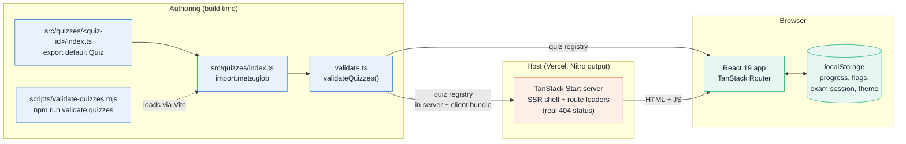
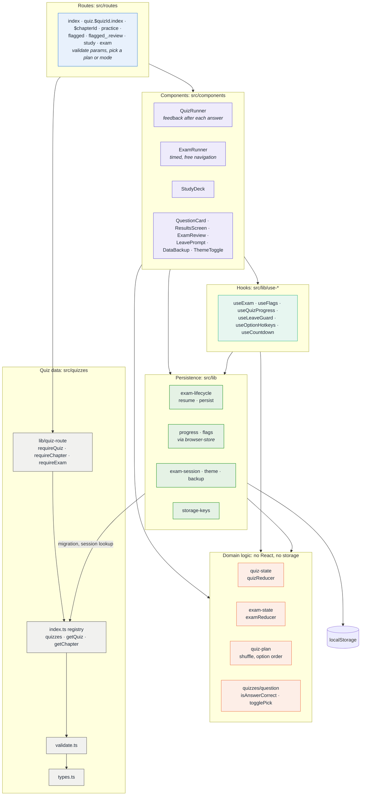
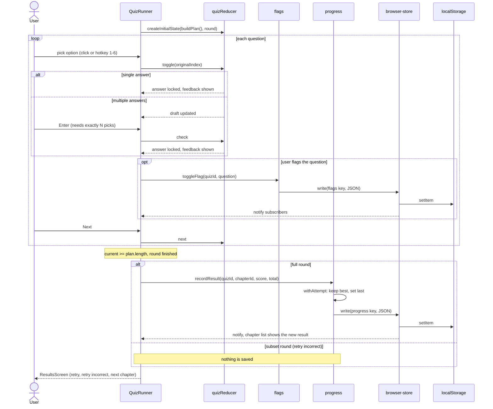

# Quiz Generator

A small multiple-choice quiz app (TanStack Start, React 19, Vite, TypeScript). Quizzes are plain
TypeScript data, split into chapters, with single- and multi-answer questions, explanations and
a results screen. Ships with one example quiz: AZ-900 (`src/quizzes/az-900/`).

## Run

```bash
npm install
npm run dev      # http://localhost:3000
npm run build    # production build
npm run preview  # serve the production build
```

## Adding a quiz

Everything lives in one new folder, `src/quizzes/<quiz-id>/`. No registry, route or component
needs to change: quizzes are auto-discovered and appear on the home page.

1. **Fork or clone** this repo and run `npm install`.
2. **Easy path: ask your AI coding agent** (Claude Code, Codex, Cursor, ...):

   > Add a quiz based on `<file or topic>`. Follow AGENTS.md.

   `AGENTS.md` (also loaded via `CLAUDE.md`) gives the agent the full rules: file layout, the
   skeleton, validation rules and content guidelines.

3. **Manual path:** create `src/quizzes/<quiz-id>/index.ts` that default-exports a `Quiz`
   (types: [`src/quizzes/types.ts`](src/quizzes/types.ts), full example:
   [`src/quizzes/az-900/`](src/quizzes/az-900)):

   ```ts
   import type { Quiz } from '../types'

   const quiz: Quiz = {
     id: 'my-quiz', // URL slug, match the folder name
     title: 'My Quiz',
     description: 'Shown on the home page.',
     chapters: [
       {
         id: '1-basics',
         number: 1,
         title: 'Basics',
         questions: [
           {
             question: 'Which option is correct?',
             options: ['Right', 'Wrong 1', 'Wrong 2', 'Wrong 3'],
             correctIndex: 0,
             explanation: 'Why it is correct.',
           },
         ],
       },
     ],
   }

   export default quiz
   ```

   Multi-answer questions use `correctIndexes: [0, 1]` instead of `correctIndex`.

4. **Verify:**

   ```bash
   npx prettier --write src/quizzes/<quiz-id>
   npx tsc --noEmit
   npm run lint
   npm run validate:quizzes   # checks ids, option counts, answer indexes, ...
   npm run dev                # see it on http://localhost:3000
   ```

5. **That's it.** Nothing outside the new folder changes. A broken quiz fails fast, with the
   quiz/chapter/question location, both in `npm run validate:quizzes` and when the app loads.

## Architecture

There is no backend or database: quizzes are TypeScript data bundled into the app, and everything
the user produces (progress, flags, an unfinished mock exam, the theme) lives in the browser's
`localStorage`. Routes stay thin, game rules live in pure reducers, and a small set of stores keeps
the UI in step with storage.



Layers, from routes down to storage (dependencies point downwards):



A chapter round, from answer to saved result:



More in [`docs/`](docs):

- [`docs/architecture.md`](docs/architecture.md): system overview, layers, routes and rendering
  modes, data model, persisted keys.
- [`docs/sequence-diagrams.md`](docs/sequence-diagrams.md): opening a page, chapter round, mock
  exam, flags, backup import and cross-tab sync.

## Scripts

| Command                    | What it does                             |
| -------------------------- | ---------------------------------------- |
| `npm run dev`              | Dev server on port 3000                  |
| `npm run build`            | Production build                         |
| `npm run lint`             | ESLint                                   |
| `npm run check`            | Prettier check                           |
| `npm run format`           | Prettier write + ESLint fix              |
| `npm run validate:quizzes` | Validate all quizzes and print a summary |

## Deploy

Includes a `vercel.json`; import the repo in Vercel and deploy (Nitro output).
