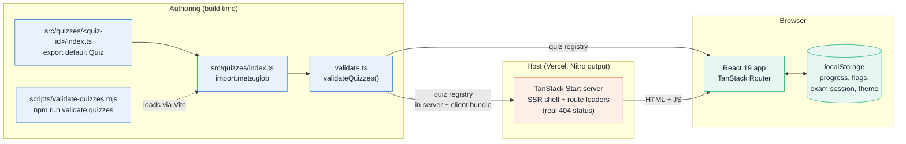
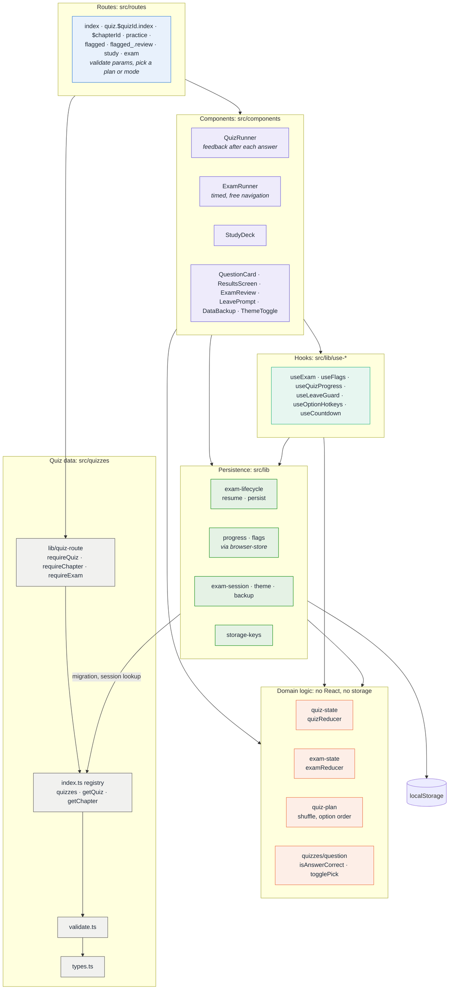
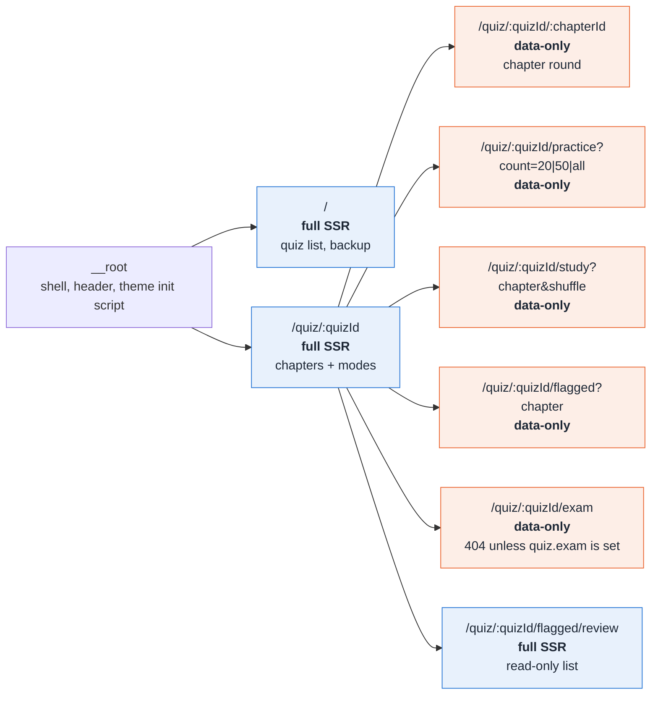
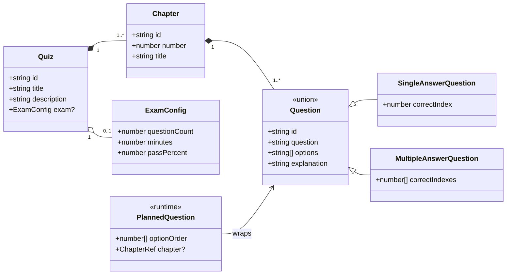

# Architecture

Quiz Generator is a TanStack Start app (React 19, Vite, Nitro) with **no backend and no database**.
Quizzes are plain TypeScript data compiled into the bundle; everything the user produces (progress,
flags, an unfinished mock exam, the theme) lives in the browser's `localStorage`.

Diagrams are [Mermaid](https://mermaid.js.org/) and render on GitHub. For runtime flows see
[sequence-diagrams.md](./sequence-diagrams.md).

Contents: [System overview](#system-overview) · [Layers](#layers-and-dependencies) ·
[Routes](#routes-and-rendering) · [Data model](#data-model) · [Persisted data](#persisted-data)

## System overview

Quiz data is validated when the module graph loads, so a broken quiz fails the build, the dev
server, and `npm run validate:quizzes` with the same message. At runtime the server only renders
the shell and answers 404s; all quiz behaviour runs in the browser.

## Layers and dependencies

Dependencies point downwards. Routes stay thin: they validate params, pick a plan or a mode and
hand over to a runner component. Game rules live in pure reducers that know nothing about React or
storage; hooks and the persistence modules are the only places that touch the outside world.

Notes:

- **Finer-grained edges.** `quiz-state` and `exam-state` both use `quizzes/question` and
  `quiz-plan`; `exam-state` reuses `buildAnswers` from `quiz-state`. `exam-lifecycle` ties
  `exam-state`, `exam-session` and `progress` together. Every persistence module reads its key from
  `storage-keys`.
- **Two stores, one pattern.** `progress` and `flags` are built on `createBrowserStore`, which
  adapts `localStorage` to `useSyncExternalStore` (cached snapshot, cross-tab `storage` events).
  `exam-session`, `theme` and `backup` talk to `localStorage` directly because their needs differ
  (restoring against quiz data, applying a class to `<html>`, bulk replace).
- **Reducers are pure.** Randomness (`shuffle`, `Date.now()`) is resolved _before_ dispatch and
  passed into actions such as `retry` and `restart`, so state can be saved and restored. Building a
  plan (`quiz-plan`) is the one random step and runs on the client only.
- **`exam-lifecycle` is the glue** between the exam reducer, the saved session and recorded
  progress; `useExam` only adds React state and the clock.

## Routes and rendering

File-based routes (`src/routes`, generated tree in `src/routeTree.gen.ts`). Anything that shuffles
or reads `localStorage` uses `ssr: 'data-only'`: the loader still runs on the server (so unknown
ids return a real 404), but the component renders only in the browser, which avoids hydration
mismatches from `Math.random()`.

Legend: blue = server-rendered with client hydration; orange = loader on the server, component on
the client only. `practice`, `exam`, `study` and `flagged` are static segments that win over
`:chapterId`, which is why those four chapter ids are reserved (see `AGENTS.md`).

## Data model

`PlannedQuestion` exists only at runtime: `optionOrder[position]` is the _original_ option index
shown at that position, so correctness is always compared against original indexes and quiz data
is never mutated.

## Persisted data

Everything is in the user's browser; nothing leaves it. Key strings are a persisted contract: never
change one, bump the version suffix and migrate (see `src/lib/storage-keys.ts`).

| Key                                     | Owner             | Content                                        | In backup |
| --------------------------------------- | ----------------- | ---------------------------------------------- | --------- |
| `quiz-generator:progress:v1`            | `progress.ts`     | Best and last result per chapter and mock exam | yes       |
| `quiz-generator:flags:v2`               | `flags.ts`        | Flagged question ids per quiz                  | yes       |
| `quiz-generator:flags:v1`               | `flags.ts`        | Legacy question texts, read until a v2 exists  | yes       |
| `quiz-generator:exam-session:v1:<quiz>` | `exam-session.ts` | Unfinished mock exam (references, not content) | no        |
| `quiz-generator:theme:v1`               | `theme.ts`        | `light` or `dark` (bare string)                | no        |

An exam session stores `(chapterId, questionIndex, questionText, optionOrder)` per question. On
load it is resolved against the _current_ quiz data and discarded wholesale if anything no longer
lines up, so a deploy that edits a quiz can't resurrect stale questions.
