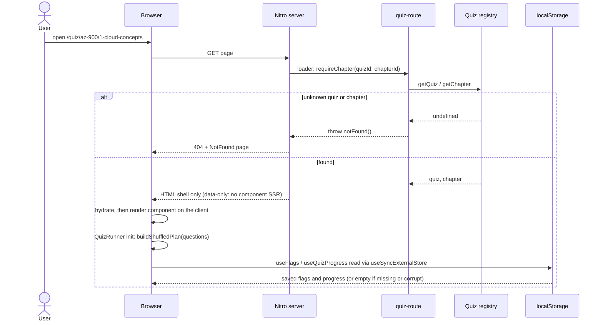
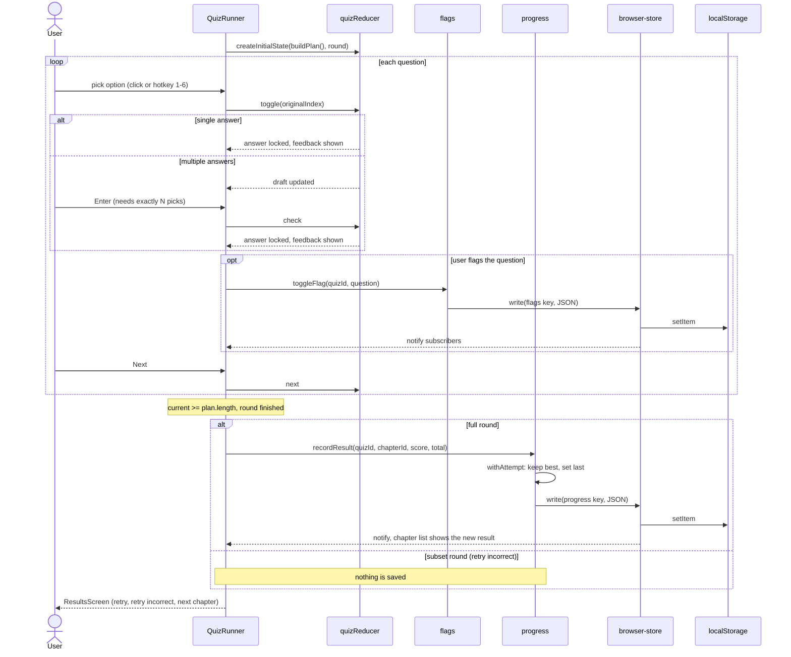
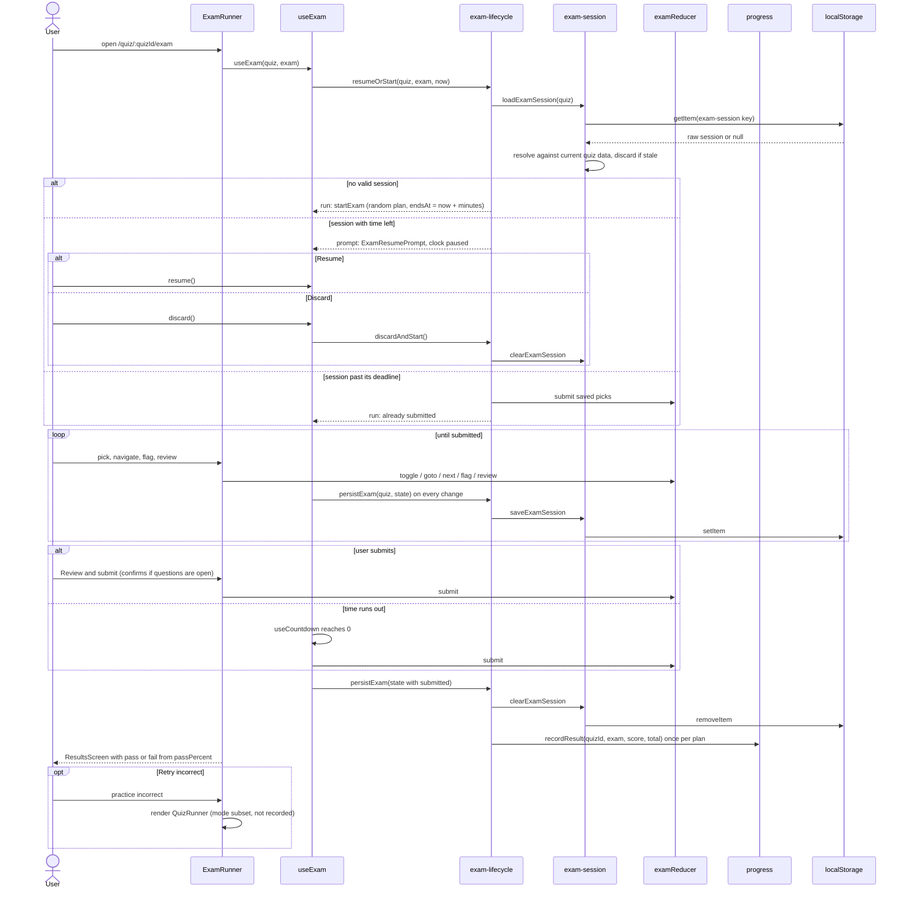
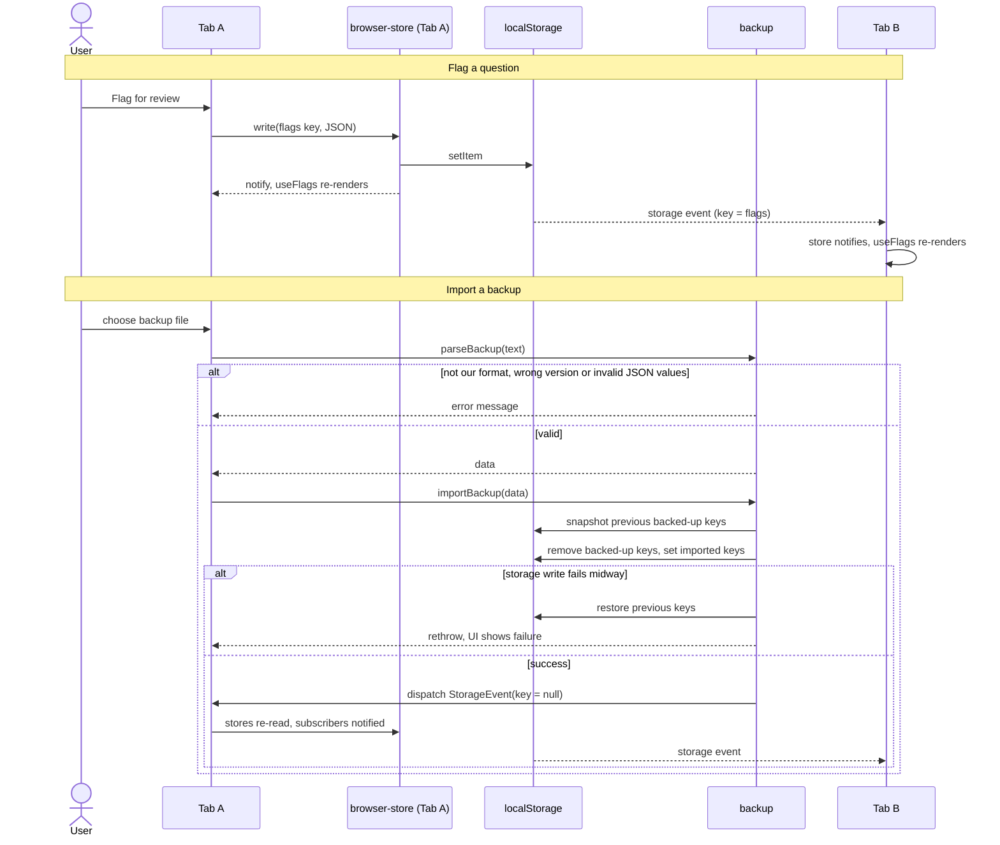

# Sequence diagrams

Runtime flows of the main features. Structure and module boundaries are in
[architecture.md](./architecture.md). Diagrams are [Mermaid](https://mermaid.js.org/) and render on
GitHub.

Contents: [Opening a quiz page](#1-opening-a-quiz-page) · [Chapter round](#2-chapter-round-with-immediate-feedback) ·
[Mock exam](#3-mock-exam) · [Flags, backup and cross-tab sync](#4-flags-backup-import-and-cross-tab-sync)

## 1. Opening a quiz page

What the server does versus the browser, for a route with `ssr: 'data-only'` (chapter, practice,
study, flagged, exam). Saved data is invisible to the server, so the first render shows none and
the stores fill in right after hydration.

## 2. Chapter round with immediate feedback

The flow behind `QuizRunner`. All round state is a reducer; the only side effects are the flag
toggle and recording the result once when the round finishes. Retrying only the incorrect questions
starts a _subset_ round that is never recorded.

Leaving mid-round: `useLeaveGuard` holds in-app navigation behind a `LeavePrompt` and enables the
browser's `beforeunload` dialog, but only once at least one answer exists. Nothing is saved before
the end, so leaving discards the round.

## 3. Mock exam

Timed, no feedback, free navigation. Unlike a chapter round the exam is persisted on every change,
so a reload or accidental navigation can be resumed, and the deadline is a timestamp so a throttled
background tab stays accurate.

## 4. Flags, backup import and cross-tab sync

`createBrowserStore` is the single mechanism that keeps components in step with `localStorage`:
local writes call `notify()`, other tabs are reached through the native `storage` event, and an
import dispatches a synthetic `storage` event with `key: null` ("everything changed").

Device-local keys (theme, exam session) are neither exported nor touched by an import, so importing
a backup never interrupts a running exam or flips the theme.
